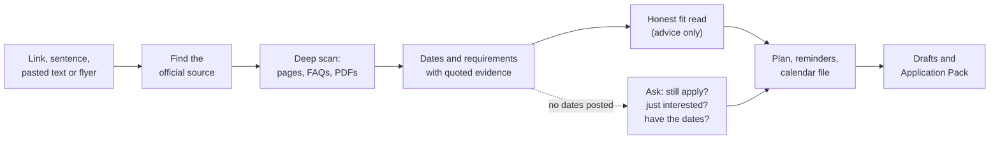
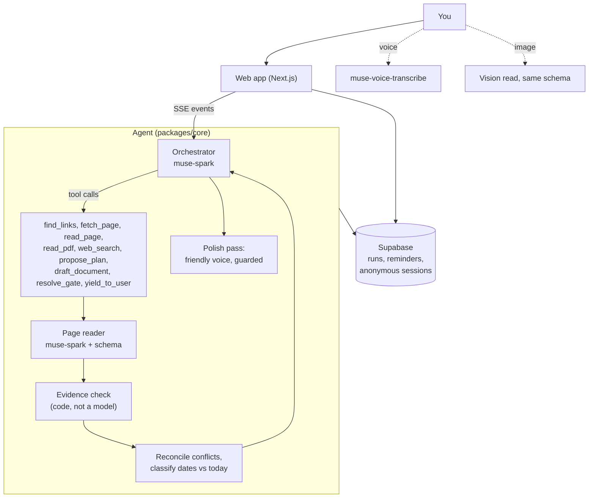
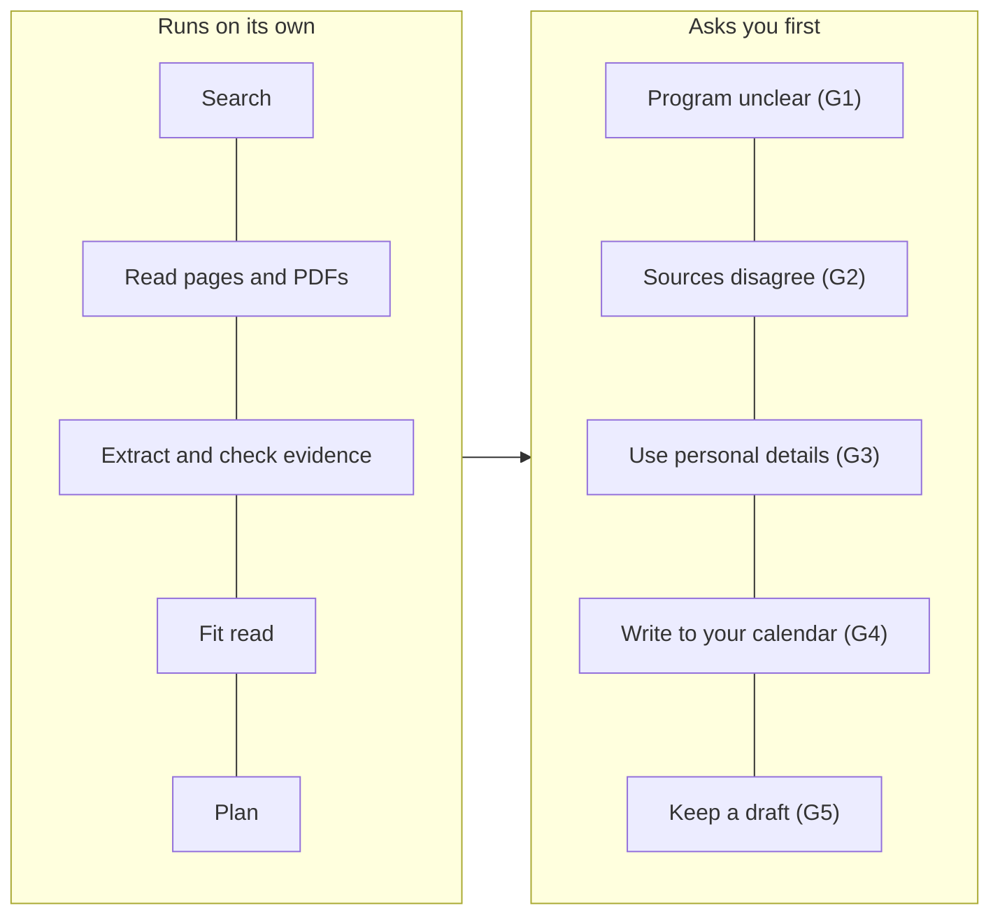

# Mizzou

**From link to executed application.**

Mizzou is a personal opportunities agent. Give it a link, a sentence, a pasted posting or a photo of a flyer. It finds the official source, reads the whole site and its PDFs, pulls out every date and requirement with the exact quote that proves it, tells you honestly whether you fit, builds your reminders and calendar, and drafts your materials. It works on its own and only stops for things that are yours to decide.

Built on Meta's Muse models for the Meta Global AI Developer Hackathon (Indie track). Try it with no signup: open the app and you are in.

## Why it matters

People lose opportunities to application fatigue, not lack of talent. The rules sit across a program page, a FAQ and a PDF. Deadlines differ by track and timezone. Opening dates are often unpublished. Every application wants its own essay. Students without an advisor do this alone, for dozens of opportunities at once.

## What Mizzou does



1. **Understands the goal** from text, a link, a pasted posting, a screenshot or a voice note.
2. **Finds the official source.** A pasted link is taken as the program and read straight away. When it has to search, it asks you to confirm the match first.
3. **Reads like a person would.** The program page, then the apply, dates, eligibility and FAQ pages and linked PDFs, each read once, within a fixed page budget.
4. **Proves what it reports.** Every date and requirement carries a source page and an exact quote. Code re-reads the quote and checks that it supports the value before it is trusted.
5. **Says what it could not find.** If the pages post no dates, Mizzou says so plainly and asks one question: do you still want to apply, are you just interested, or do you have the dates from somewhere. Dates you give are marked as yours, not verified.
6. **Gives a fit read in plain words.** Advice, never a score. The decision stays with you.
7. **Plans and follows through.** A reminder plan, an `.ics` file, optional Google Calendar events, and a check-again reminder when an opening date is unpublished. Due reminders greet you when you come back, with Done, Snooze and Help me.
8. **Drafts.** A first draft of your statement, edits by chat ("make it more academic"), and an Application Pack: checklist, copy-ready answers, recommender and registrar email drafts, and the link to the real portal.

## How it runs



- **A model-driven loop, not a script.** The orchestrator chooses its own tools each round. A case file in the run state lists what is known and what is still missing, so the agent closes the gaps itself.
- **Resumable.** Runs are stored. A long task carries on across requests, and an approval can stay open for days without losing work.
- **Never repeats itself.** Pages already read and searches already made are not repeated in a run. An announced next step that is not taken gets a single nudge to do it.

## Autonomous, with approvals only where it counts



Mizzou never sends email, never submits an application and never logs in as you. When a page blocks automated readers, needs JavaScript or sits behind a login, it names the page and asks you to paste the text. It respects robots.txt.

## What makes it strong

| Strength | How it shows up |
|---|---|
| **Evidence, not vibes** | Each field has a source URL and an exact quote, verified by code. Anything it could not verify is labeled as not verified. |
| **Honest about gaps** | Passed deadlines are never shown as next. Missing dates trigger a question, not a guess. |
| **Autonomous** | Pasting a link starts the whole workflow with no questions. Approvals exist only for sensitive actions. |
| **Trusts your input** | A flyer, screenshot or link is a lead to check against the official page, then reported back in friendly language. |
| **Acts on the result** | Reminders, an `.ics` file and idempotent Google Calendar sync (retries never duplicate events), with a check-again reminder for unpublished dates. |
| **No signup** | Opening the app starts an anonymous session. Google is optional and keeps your chats. |
| **Voice and vision** | Record a note (it lands in the composer for you to edit, never auto-sent) or attach a flyer image. |
| **Cost guarded** | Per-user and global daily budgets, per-IP rate and upload caps, a page budget per run, and an optional Cloudflare check. |
| **Friendly voice** | Working steps fold into one animated row. The closing answer is rewritten in a warm voice and a code guard rejects any rewrite that loses a link or a number. |

## Meta models used

| Model | Where | Role |
|---|---|---|
| `muse-spark` (Meta Model API, Responses API) | `packages/core/src/meta` | Orchestrator, page reader, fit judge, draft writer, flyer vision, final-answer polish, `web_search` grounding |
| `muse-voice-transcribe` | `apps/web/src/app/api/transcribe` | Voice notes up to 60 seconds |
| Muse Code | development | The coding agent used to build this project |

## Evaluation

A labeled set of real opportunities (programs, fellowships, an internship board, PDFs, flyers) lives in `packages/eval`, scored for deadlines correct, requirement recall and evidence validity, single page versus deep scan. The label file was reviewed against the saved fixtures, see `docs/LABELS_REVIEW.md`. Only one baseline case has been scored so far (see `docs/EVAL_REPORT.md`), so no headline numbers are claimed here.

## Repository

```
apps/web         Next.js app: chat, overlays, approvals, API routes
packages/core    The agent: loop, tools, gates, run state, evidence checks, model client
packages/eval    Labeled cases, fixtures, scoring
supabase         Tables and row-level security
docs             Architecture, API notes, eval report, retention policy
```

More detail in `docs/ARCHITECTURE.md`. The demo walkthrough is in `DEMO_SCRIPT.md`.

## Run it

```
pnpm install
pnpm dev
```

Copy `.env.example` to `.env.local` (git-ignored) and fill the variables. Never commit keys. The service-role key stays server-only, and Google credentials are configured in Supabase, not in app code.

## Known limits

- Pages that need a login or render only with JavaScript cannot be read automatically. Mizzou names the page and asks for pasted text.
- Information that exists only in emails or phone calls is out of reach.
- Application forms sit behind logins, so Pack answers come from public requirements and are marked "check against the portal" where unconfirmed.
- Hosted on Vercel Hobby, so long runs continue across several short requests.

## Built during the hackathon

Everything here was built between Oct 27 and Nov 4, 2026, for the Meta Model API hackathon (Indie track), using Muse Code. Open-source libraries are used under their own licenses.
