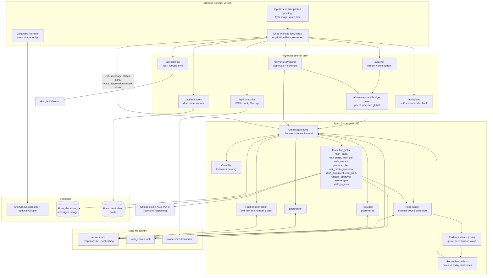
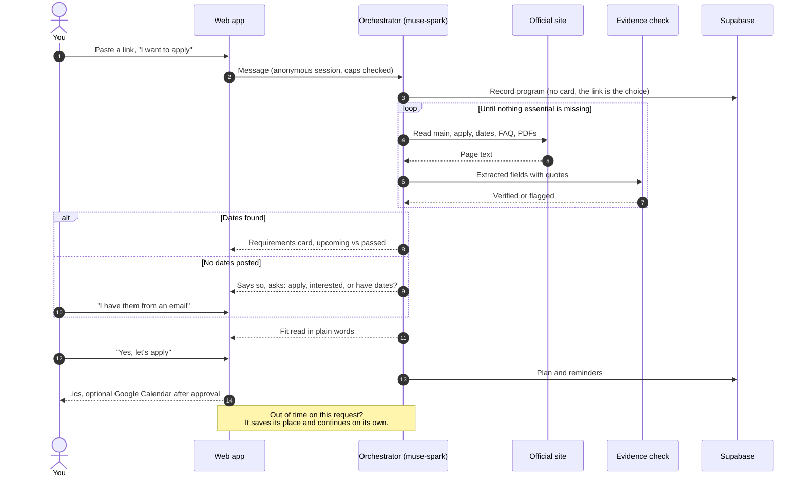
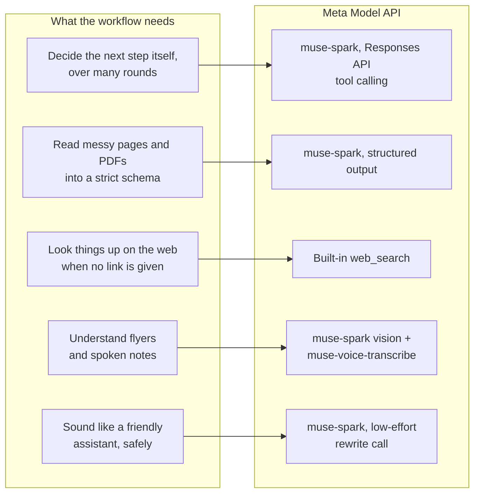
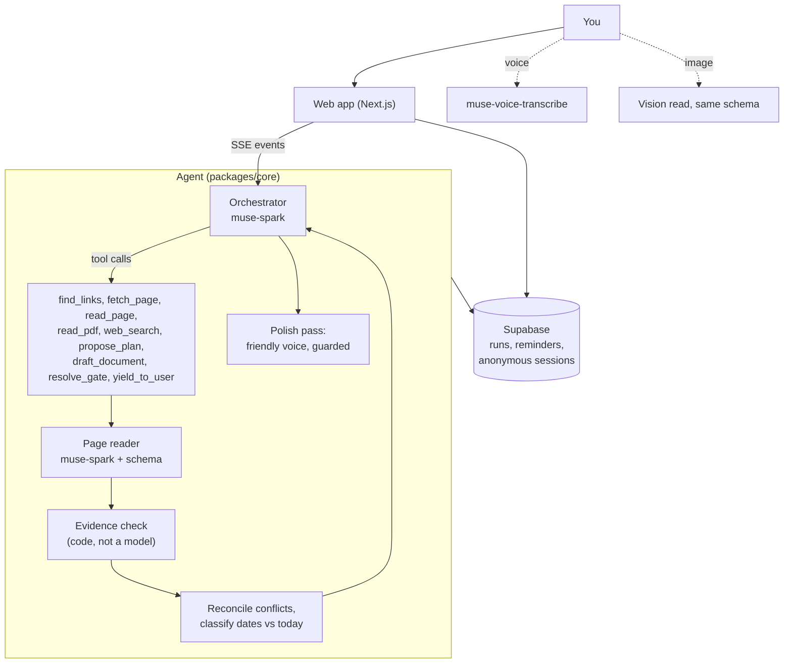
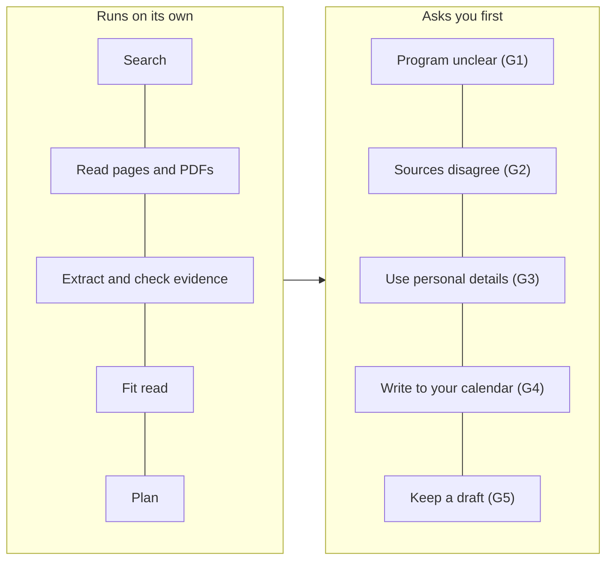
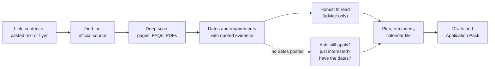

# Mizzou

**From link to executed application.**

Mizzou is a personal opportunities agent. Give it a link, a sentence, a pasted posting or a photo of a flyer. It finds the official source, reads the whole site and its PDFs, pulls out every date and requirement with the exact quote that proves it, tells you honestly whether you fit, builds your reminders and calendar, and drafts your materials. It works on its own and only stops for things that are yours to decide.

Built on Meta's Muse models for the Meta Global AI Developer Hackathon (Indie track). Try it with no signup: open the app and you are in.

## At a glance (for reviewers)

| | |
|---|---|
| **What it is** | An autonomous agent that turns an opportunity link into a verified plan, calendar and drafts |
| **Core idea** | Every date and requirement is traceable to a source page and an exact quote, and code (not a model) verifies the quote before the value is trusted |
| **Agent design** | Model-driven tool loop on `muse-spark` (Responses API), a case file of known vs missing facts, resumable stored runs, approval gates only for sensitive actions |
| **Muse surface used** | Tool calling, structured output, built-in `web_search`, vision, `muse-voice-transcribe`, a low-effort rewrite call |
| **Reliability engineering** | Per-request time budget with automatic continue across short serverless requests, duplicate-work guards, idempotent calendar writes, guarded rewrite of final answers |
| **Safety and cost** | Never sends email, submits or logs in as the user. Per-user and global budgets, per-IP caps, anonymous session retention limits |
| **Try it** | mizzou.vercel.app, no signup. Walkthrough in `DEMO_SCRIPT.md` |

## Full system architecture

One picture of the whole workflow, from the browser to the models and back.



### One request, step by step



## Technical depth

**1. A real agent loop, not a script.** `runConversationTurn` calls the model with a tool set (`find_links`, `fetch_page`, `read_page`, `read_pdf`, `web_search`, `propose_plan`, `ask_profile_question`, `draft_document`, `edit_draft`, `request_approval`, `resolve_gate`, `yield_to_user`). The model picks the next tool each round. Rounds replay the stored thread, de-duplicated by item id, so a run can resume on any later request.

**2. Evidence verified by code.** The reader extracts into a strict zod schema. Each field carries `source_url` and an exact `quote`. A deterministic check re-reads the quote against the page text, and fields that fail are downgraded or flagged, never silently kept. Image reads use the same schema with an extra date-honesty check so an invented date is marked unchecked.

**3. A case file that keeps it moving.** From the persisted run state, code lists what is known and what is still missing (no deadline yet, every deadline passed, no requirements yet). The model closes read-only gaps itself and ends its turn with `yield_to_user`. If it announces a step and stops, a single nudge makes it do the step.

**4. Built for serverless limits.** Vercel Hobby caps a function at 60 seconds. Each request has a time budget. When it runs out the turn saves its place, tells the client to `continue`, and the client resumes in a fresh request, up to a fixed number of times. Pages already read and searches already made are not repeated in a run.

**5. Honest dates.** Deadlines are normalised to UTC for storage but shown in their original local time first. Each is classified against today as upcoming or passed. A passed deadline is never presented as next, and an unpublished opening date gets a check-again reminder.

**6. Idempotent actions.** Google Calendar events use deterministic ids derived from the plan hash, so retries address the same events and a 409 counts as success. The `.ics` export works for everyone.

**7. A trusted voice.** Working steps fold into one animated row. The closing answer is rewritten by a short low-effort model call, and a guard rejects the rewrite if any link or digit run is lost, falling back to the original.

**8. Guardrails.** Budget guard before every paid call, per-IP rate, upload and run caps, WAV and image sniffing by content not extension, robots.txt respected, personal data never sent to a training-data model variant.

## Why Mizzou would fail without the Muse models

Mizzou is not a chatbot with a nice skin. Its workflow needs four things in one stack, and the Meta Model API supplies all four behind a single key and a single cost ledger. Take any one away and a core promise breaks.



| Without this | What breaks in Mizzou |
|---|---|
| **Tool-calling orchestration** (`muse-spark` on the Responses API) | There is no agent. The "paste a link and watch it finish" flow is a loop where the model picks `find_links`, `read_page`, `read_pdf`, `web_search` and the approval tools round after round. Without reliable tool calls it collapses into a fixed script that cannot adapt to a site laid out differently. |
| **Schema-bound reading** | Evidence is the product. Every date needs a source and an exact quote that code can re-check. A model that drifts from the schema or paraphrases its quotes produces dates nobody can trust, and the verification step rejects them. |
| **Built-in `web_search`** | "Cambridge Mastercard Foundation scholarship" with no link needs a search that returns sources the agent then reads. Without it the agent cannot find the official source on its own and every user would have to bring a link. |
| **Vision on the same model** | A flyer or screenshot is read into the same extraction schema as a web page, so it flows through the same checks. A separate OCR plus a second model would split the evidence trail. |
| **`muse-voice-transcribe`** | Voice notes become editable text in the composer. Many applicants are on phones, where speaking is faster than typing. |
| **One vendor, one key, one ledger** | Mizzou runs on a hard budget (a provider limit, a project cap, a per-user daily cap). Every call is priced and logged in one place, so the budget guard can stop a run before it overspends. Mixing providers would make that guard guesswork. |
| **Low-effort rewrite call** | The warm, trusted voice comes from a short second call that rewrites the closing answer. A code guard throws the rewrite away if it loses a link or a number. This only pays off when the call is fast and cheap. |

Put plainly: the product promise is "it reads the real source, proves it, and acts", and that promise is built out of these capabilities. This is how Mizzou is designed, not a claim that nothing else could ever be made to work.

## Meta models used

| Model | Where | Role |
|---|---|---|
| `muse-spark` (Meta Model API, Responses API) | `packages/core/src/meta` | Orchestrator, page reader, fit judge, draft writer, flyer vision, final-answer polish, `web_search` grounding |
| `muse-voice-transcribe` | `apps/web/src/app/api/transcribe` | Voice notes up to 60 seconds |
| Muse Code | development | The coding agent used to build this project |

## How it runs



- **A model-driven loop, not a script.** The orchestrator chooses its own tools each round. A case file in the run state lists what is known and what is still missing, so the agent closes the gaps itself.
- **Resumable.** Runs are stored. A long task carries on across requests, and an approval can stay open for days without losing work.
- **Never repeats itself.** Pages already read and searches already made are not repeated in a run. An announced next step that is not taken gets a single nudge to do it.

## Autonomous, with approvals only where it counts



Mizzou never sends email, never submits an application and never logs in as you. When a page blocks automated readers, needs JavaScript or sits behind a login, it names the page and asks you to paste the text. It respects robots.txt.

## What Mizzou does



1. **Understands the goal** from text, a link, a pasted posting, a screenshot or a voice note.
2. **Finds the official source.** A pasted link is taken as the program and read straight away. When it has to search, it asks you to confirm the match first.
3. **Reads like a person would.** The program page, then the apply, dates, eligibility and FAQ pages and linked PDFs, each read once, within a fixed page budget.
4. **Proves what it reports.** Every date and requirement carries a source page and an exact quote. Code re-reads the quote and checks that it supports the value before it is trusted.
5. **Says what it could not find.** If the pages post no dates, Mizzou says so plainly and asks one question: do you still want to apply, are you just interested, or do you have the dates from somewhere. Dates you give are marked as yours, not verified.
6. **Gives a fit read in plain words.** Advice, never a score. The decision stays with you.
7. **Plans and follows through.** A reminder plan, an `.ics` file, optional Google Calendar events, and a check-again reminder when an opening date is unpublished. Due reminders greet you when you come back, with Done, Snooze and Help me.
8. **Drafts.** A first draft of your statement, edits by chat ("make it more academic"), and an Application Pack: checklist, copy-ready answers, recommender and registrar email drafts, and the link to the real portal.

## Why it matters

People lose opportunities to application fatigue, not lack of talent. The rules sit across a program page, a FAQ and a PDF. Deadlines differ by track and timezone. Opening dates are often unpublished. Every application wants its own essay. Students without an advisor do this alone, for dozens of opportunities at once.

## What makes it strong

| Strength | How it shows up |
|---|---|
| **Evidence, not vibes** | Each field has a source URL and an exact quote, verified by code. Anything it could not verify is labeled as not verified. |
| **Honest about gaps** | Passed deadlines are never shown as next. Missing dates trigger a question, not a guess. |
| **Autonomous** | Pasting a link starts the whole workflow with no questions. Approvals exist only for sensitive actions. |
| **Trusts your input** | A flyer, screenshot or link is a lead to check against the official page, then reported back in friendly language. |
| **Acts on the result** | Reminders, an `.ics` file and idempotent Google Calendar sync (retries never duplicate events), with a check-again reminder for unpublished dates. |
| **No signup** | Opening the app starts an anonymous session. Google is optional and keeps your chats. |
| **Voice and vision** | Record a note (it lands in the composer for you to edit, never auto-sent) or attach a flyer image. |
| **Cost guarded** | Per-user and global daily budgets, per-IP rate and upload caps, a page budget per run, and an optional Cloudflare check. |
| **Friendly voice** | Working steps fold into one animated row. The closing answer is rewritten in a warm voice and a code guard rejects any rewrite that loses a link or a number. |

## Who it is for, and why this is an Indie project

**The applicant.** Mizzou is built for the student or early-career applicant with no advisor: someone applying across time zones for fellowships, scholarships, graduate programs and internships, often from a phone, often on a tight data budget, with deadlines that differ by track and are sometimes simply not published. The defaults reflect that. The assistant works in the user's own time zone (Africa/Lagos by default), opens with no signup, accepts a voice note or a photographed flyer, and is honest when a page posts no dates instead of guessing.

**The builder.** Mizzou is a solo build for the Indie track, made by a student who lives this problem: scattered requirements, unclear deadlines, one essay per application. That shows in the choices:

| Choice | Why it fits one builder and one real user |
|---|---|
| One focused problem, finished end to end | Link to plan to calendar to draft, instead of a wide demo that stops halfway |
| No signup, optional Google | The first run takes seconds, so the idea can be judged on the work |
| Hard cost caps and a budget guard | A solo project must never run away with money |
| Honesty over polish | Unverified is labeled as unverified, and the agent says what it could not find |
| Advice only | The applicant keeps every decision, and nothing is sent or submitted for them |

## Evaluation

A labeled set of real opportunities (programs, fellowships, an internship board, PDFs, flyers) lives in `packages/eval`, scored for deadlines correct, requirement recall and evidence validity, single page versus deep scan. The label file was reviewed against the saved fixtures, see `docs/LABELS_REVIEW.md`. Only one baseline case has been scored so far (see `docs/EVAL_REPORT.md`), so no headline numbers are claimed here.

## After the hackathon

Mizzou is meant to become a full personal agent for everyone who chases opportunities, not a feature that lives inside someone else's chat app. The plan, in priority order:

1. **Open source the engine.** Release `packages/core` (the evidence-checked extraction and the case-file agent loop) under a permissive license, so others can build on a reader whose every field can be verified.
2. **Make quality measurable.** Finish scoring the full labeled set in `packages/eval` (deadlines correct, requirement recall, evidence validity, single page vs deep scan), publish the numbers and the method, and use the harness so every change has to prove it made the agent more correct.
3. **Find scattered opportunities for the user.** Opportunities rarely arrive as a clean link. They sit in emails, forwarded messages, group chats and flyers. With the user's explicit permission, and read-only, Mizzou could scan places like Gmail and messaging apps for deadlines and offers, check each one against the official source, and bring them into one plan. This depends on stronger vision and agent abilities in upcoming Muse releases, and on a privacy model where the user chooses what is read, nothing leaves their account, and nothing is stored beyond what the task needs.
4. **A full app.** Grow the web app into a complete personal agent: persistent profile and history, a proper inbox of opportunities, watching pages for newly published dates, and a shared mode for career offices and student communities.
5. **The Meta ecosystem.** A partnership with Meta would let Mizzou go where applicants already are. Think of a flyer or poster seen through smart glasses becoming a verified deadline and a reminder before you reach the next corner, or Mizzou working across Meta's apps and devices. This is an ambition that depends on a partnership, not something that exists today.
6. **The company path.** The aim is a real-life personal agent for everyone, from students to job seekers and founders. Whether that means raising money or staying independent is a decision to make once there are real users and published eval numbers to show.

## Repository

```
apps/web         Next.js app: chat, overlays, approvals, API routes
packages/core    The agent: loop, tools, gates, run state, evidence checks, model client
packages/eval    Labeled cases, fixtures, scoring
supabase         Tables and row-level security
docs             Architecture, API notes, eval report, retention policy
```

More detail in `docs/ARCHITECTURE.md`. The demo walkthrough is in `DEMO_SCRIPT.md`.

## Run it

```
pnpm install
pnpm dev
```

Copy `.env.example` to `.env.local` (git-ignored) and fill the variables. Never commit keys. The service-role key stays server-only, and Google credentials are configured in Supabase, not in app code.

## Known limits

- Pages that need a login or render only with JavaScript cannot be read automatically. Mizzou names the page and asks for pasted text.
- Information that exists only in emails or phone calls is out of reach.
- Application forms sit behind logins, so Pack answers come from public requirements and are marked "check against the portal" where unconfirmed.
- Hosted on Vercel Hobby, so long runs continue across several short requests.

## Built during the hackathon

Everything here was built between Oct 27 and Nov 4, 2026, for the Meta Model API hackathon (Indie track), using Muse Code. Open-source libraries are used under their own licenses.
