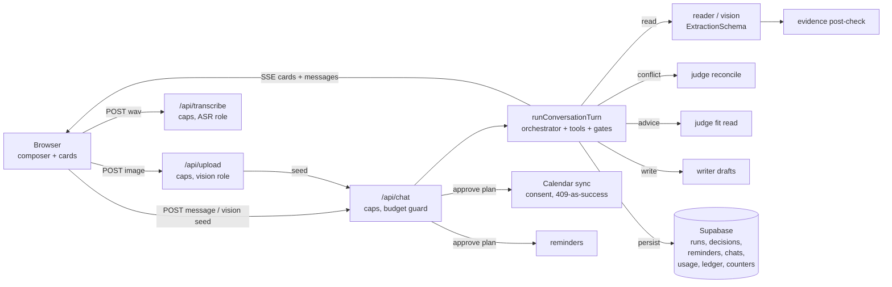

# Mizzou architecture (shipped parts only, Oct 31 2026)

One repository, one language (TypeScript), one deploy. The agent lives in
`packages/core` (framework-free); `apps/web` (Next.js) and the eval script
run exactly the same code.

## Models by role (`packages/core/src/meta/registry.ts`)

| role | model | used for |
|---|---|---|
| orchestrator | `muse-spark-1.3` | drives every chat turn, picks tools, writes replies |
| reader | `muse-spark-1.3` | page/PDF text into `ExtractionSchema` |
| judge | `muse-spark-1.3` | conflict reconcile, fit read |
| writer | `muse-spark-1.3` | drafts, emails, answers, chat edits |
| vision | `muse-spark-1.3` + image input | flyer/screenshot into the same `ExtractionSchema` |
| voice | `muse-voice-transcribe-1.0` | 60s notes to editable text |

Every call goes through `callModel({ role, ... })`, which resolves the
model from the registry, validates output against a zod schema (one repair
retry), backs off on HTTP 429, fails fast on 4xx, and records
model/tokens/latency/cost. Stage 1 pass/fail note: the app is useless
without these roles, and each one earns its place above. `muse-wonder-1.0`
A/B is open (eval item E). SAM 3.1 was cut: no real 5-flyer corpus exists
in-sandbox to run the 3-of-5 test, so nothing ships half-working.

## Orchestrator loop and tools (`conversation/turn.ts`)

Each chat message runs one model turn on the orchestrator role with the
canonical prompt (`prompts/orchestrator.md`). No regex or URL branching on
the message: the model picks tools, code enforces guardrails.

Tools: `fetch_page`, `read_page`, `read_pdf`, `find_links`, `web_search`
(built-in grounding, citations kept), `list_reminders`, `propose_plan`,
`ask_profile_question`, `draft_document` / `edit_draft`, `request_approval`
(gates G1-G5), `finish`. A throwing tool returns a structured `{error}`
to the model; the run never ends on a tool failure. Only the budget guard
propagates. Stateless replay: full message history persists in the run;
reasoning items are never replayed (duplicate-id 400 fix, Oct 31).

After G1 the deep scan reads the ranked same-domain pages (FAQ, funding,
international, deadlines), the evidence post-check confirms each quote in
the fetched text (dates must be supported by their quote), and conflicts
go to the judge reconcile step.

## Gates G1-G5

G1 confirms the program (card, nothing proceeds unconfirmed). G2 resolves
conflicting pages. G3 carries the fit decision (saved once in `decisions`,
never re-asked). G4 is the plan approval that writes reminders and
offers Calendar sync. G5 halts every draft until Keep.

## Evidence, fit, drafts, pack

Cards stream as `card:*` events and stay hidden until G1 Yes. Fit is
advice: plain-words card, one "Want to go for it anyway?" question,
decision recorded once. Writer drafts carry versions with G5 Keep. The
Pack overlay (checklist, copy-ready answers with word counts, recommender
and registrar emails, portal button) assembles from settled cards.

## Upload and voice

Flyer/screenshot: client downscales to 1600px, `POST /api/upload`
(size + rate + daily-count caps, magic-byte type check), vision role
extracts, the seed merges like a read page with G1 still unconfirmed.
Voice: browser records and converts to 16 kHz mono 16-bit WAV,
`POST /api/transcribe` (60s cap, same abuse caps, duration-based cost
at $0.18/hr into the usage table), transcript lands editable in the
composer, never auto-sent.

## Sessions, data, caps

No signup: landing mints a Supabase anonymous session. Optional Google
account links via `linkIdentity` (chats and reminders kept). Calendar is
`.ics` for everyone, Google write only at Approve & Sync (incremental
consent, deterministic ids, 409-as-success, `sync_ledger`).

Supabase tables: `runs` (messages, typed working memory, pending gate),
`decisions` (gate rows, G3 carries fit), `reminders`, `chats`,
`usage` (per-call spend), `sync_ledger` (idempotent Calendar rows),
`rate_counters` (abuse caps, hashed IPs only). Retention migration 0004
deletes anonymous users and rows after 7 idle days. Caps are server-side
from env: message length, per-minute hits, per-IP daily runs and uploads,
page cap per run, upload bytes, per-user/global daily USD budgets. Limit
hits reply model-free ("I need a minute." vs tomorrow) and log
scope/amount/limit.

## Request flow

